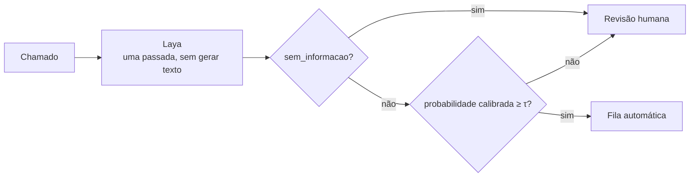

# Laya × Gemma: quando a IA pode decidir e quando precisa de revisão humana?

  

Coloquei dois modelos abertos para triar os mesmos 180 chamados de atendimento em português, com negação, ambiguidade e chamados sem informação. Quero saber quais chamados a IA pode decidir sozinha e quais precisam de uma pessoa, e respondo com números que eu medi.

------------------------------------------
Ps: o Gemma acerta mais e tem escores mais úteis. O Laya é cerca de 70 vezes mais rápido e usa cerca de 6,5 vezes menos memória. Isso foi medido em chamados sintéticos e curtos.
--------------------------------------------

## Por que escolhi o Laya

- O Laya tem código e pesos abertos (Apache 2.0) e me devolve uma distribuição de probabilidade numa única passada, sem gerar texto.
- Trato a "confiança" que um LLM escreve como texto. Por isso calculo a probabilidade do Gemma pelos logits e comparo os dois sinais separadamente.
- Não presumo que os escores do Laya estejam calibrados: ajusto uma temperatura na partição de ajuste e meço na de avaliação.

## Limitações

- Escrevi e rotulei os chamados eu mesma; eles são sintéticos e curtos.
- Com 108 chamados na avaliação, diferenças pequenas ficam dentro do intervalo de confiança.
- Rodei os dois modelos sem fine-tuning, um chamado por vez, numa única GPU.

## Licenças

Publico este repositório sob GPL-3.0. Uso o Laya sob Apache 2.0 ([NandhaKishorM/laya](https://github.com/NandhaKishorM/laya)) e o Gemma 4 sob Apache 2.0, conforme o model card; registro a licença do checkpoint que usei em `resultados/execucao.json`.

---

bel - para o hackathon com a FLUSP
